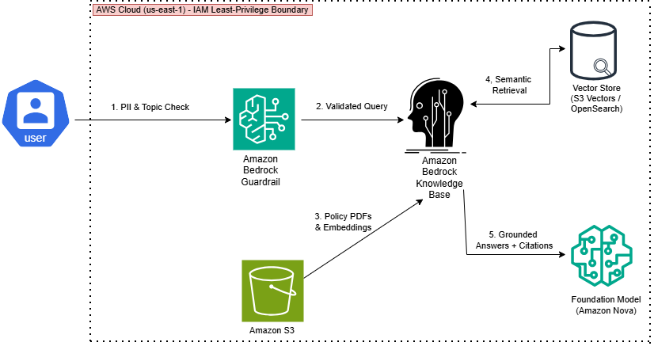
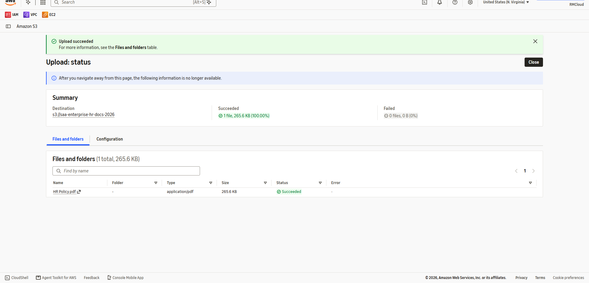
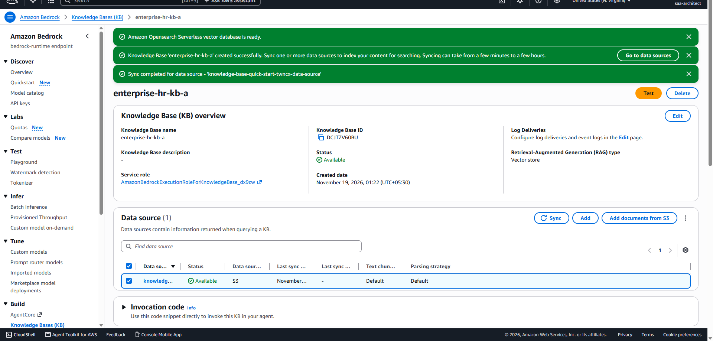
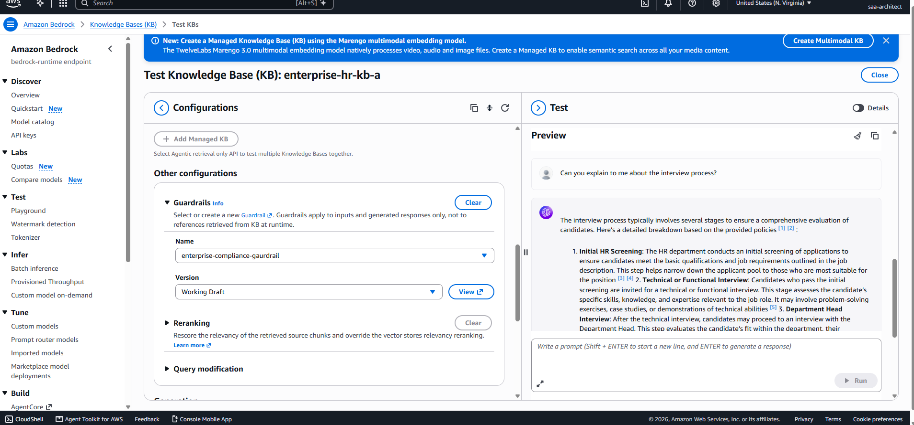
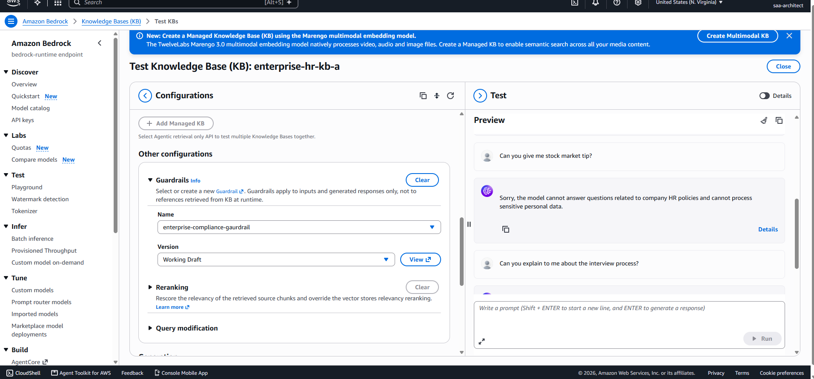

# Serverless Enterprise HR & Compliance Assistant (Amazon Bedrock)

A secure, serverless Retrieval-Augmented Generation (RAG) architecture built on AWS. This solution enables employees to query internal HR policies with verified document citations while automatically blocking off-topic requests and redacting Personally Identifiable Information (PII).

## Reference Architecture

## Business Problem & Solution
* **Challenge:** Employees struggle to find accurate answers across lengthy HR PDFs, while exposing internal documents to public AI tools risks PII leakage and hallucinations.
* **AWS Solution:** Built a zero-trust, serverless RAG pipeline using **Amazon Bedrock Knowledge Bases** and **Amazon OpenSearch Serverless** for semantic retrieval, **Amazon S3** for encrypted document storage, and **Amazon Bedrock Guardrails** for automated PII redaction and topic filtering.

## Architectural Decisions & Trade-Offs (SAA Well-Architected)

| Component | Selected AWS Service | Alternative Rejected | Architectural Trade-Off & Rationale |
| :--- | :--- | :--- | :--- |
| **RAG Orchestration** | **Amazon Bedrock Knowledge Bases** | Self-managed LangChain on EC2 | Eliminates server patching, idle compute costs, and custom chunking maintenance. |
| **Vector Store** | **Amazon OpenSearch Serverless** | Self-Hosted Vector DB on EC2 | Managed vector indexing with automated scaling and zero infrastructure administration. |
| **Security & PII Control** | **Amazon Bedrock Guardrails** | Custom Python Regex Filters | Native PII masking and denied-topic enforcement with zero custom code. |
| **Access Control** | **IAM Least-Privilege Roles** | Root User / Broad Admin Roles | Executed via dedicated IAM user (`saa-architect`); service role scoped strictly to a single S3 bucket and Guardrail ARN. |
| **Infrastructure-as-Code** | **AWS CloudFormation (YAML)** | Manual Console-Only Setup | Exported reproducible YAML template (`enterprise-bedrock-rag-template.yaml`) via AWS IaC Generator. |

## Proof of Implementation

### 1. Encrypted Document Storage (Amazon S3)

### 2. Knowledge Base Ingestion & Vector Sync

### 3. Grounded Response with Source Citations

### 4. Guardrail PII & Denied-Topic Enforcement

## Security & Infrastructure-as-Code Artifacts
* **CloudFormation Template:** [`enterprise-bedrock-rag-template.yaml`](enterprise-bedrock-rag-template.yaml)
* **IAM Least-Privilege Policy:** [`iam-least-privilege.json.docx`](iam-least-privilege.json.docx)

## FinOps Cost Management
* Configured a proactive **$5.00 AWS Budgets** alert prior to deployment.
* Cleaned up all active resources (Knowledge Base, OpenSearch Serverless collection, Guardrail, and S3 bucket) post-validation to maintain **$0.00 ongoing idle cost**.
